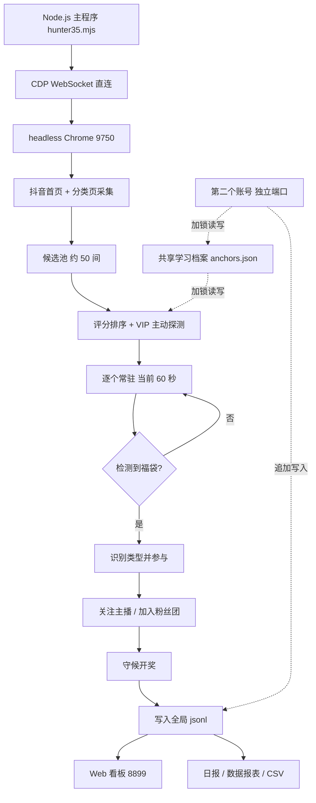

# 抖音直播间福袋自动发现与参与系统：headless Chrome + CDP

> 用 headless Chrome 与 Chrome DevTools Protocol 驱动抖音网页版直播间，自动采集房间、识别福袋、点击参与、关注主播或加入粉丝团、守候开奖并写入本地数据看板；运行时零第三方依赖，纯 Node.js 内置模块实现。

**一句话定位**：这是一个**个人自动化工具**，不是通用产品，也不是已稳定验证的商业系统。它在整个体系里的位置是「抖音福袋」项目的**公开源码白名单仓库**：只放可复现运行所需的脚本、配置模板与文档，账号登录态、运行数据、截图产物一律不入库。

- 本仓库：<https://github.com/DLDLDL13579/douyin-fudai-agent>
- 仓库元数据：公开仓库，默认分支 `main`，主语言 JavaScript，体积 244 KB，star / fork 为 0 / 0，创建于 2026-11-04，最后 push 2026-11-05。
- 同一 GitHub 账号下的其他技术仓库：<https://github.com/DLDLDL13579/our-nest-miniprogram>、<https://github.com/DLDLDL13579/av-anomaly-detection>。
- 迁移记录（`AGENTS.md`）：2026-11-02 从 `个人项目/杂活/douyin-auto` 与 `/tmp/douyin-probe` 整体迁入本工作区，`/tmp` 副本会被系统清理，故不再分两处存放；脚本内 207 处绝对路径已同步改写。

> 本文以代码与配置文件为准。`AGENTS.md`、`ARCHITECTURE.md`、`LICENSE`、`package.json`、`data/wait-config.json`、`scripts/run-h35.sh`、`web/run-web.sh` 均按源文件核对；文档与代码不一致之处，已在「十二、已知问题与限制」逐条点明。

---

## 目录

- [一、项目定位](#一项目定位)
- [二、现状 / 状态表](#二现状--状态表)
- [三、技术架构](#三技术架构)
- [四、目录结构](#四目录结构)
- [五、快速开始](#五快速开始)
- [六、核心实现](#六核心实现)
- [七、配置参数表](#七配置参数表)
- [八、多账号并行](#八多账号并行)
- [九、Web 看板](#九web-看板)
- [十、数据报表](#十数据报表)
- [十一、Windows 绿色分发版](#十一windows-绿色分发版)
- [十二、已知问题与限制](#十二已知问题与限制)
- [十三、合规与安全声明](#十三合规与安全声明)
- [十四、开发历程与踩坑记录](#十四开发历程与踩坑记录)
- [十五、归属与许可证](#十五归属与许可证)

---

## 一、项目定位

抖音直播间会不定时发放「福袋」，用户需在倒计时内完成指定动作才能参与，常见条件有三类：

| 类型 | 参与条件 |
|:---|:---|
| 评论型 | 发送指定评论 |
| 评论 + 关注型 | 关注主播并发送评论 |
| 粉丝团型 | 加入粉丝团（通常消耗 1 抖币）并发送评论 |

人工盯守需要持续刷新几十个直播间，且福袋出现时间不可预测。本项目用 headless Chrome 直接驱动抖音网页版，通过一个 CDP 长连接完成「采集房间 → 评分排序 → 逐个常驻 → 检测福袋 → 点击参与 → 关注主播 / 加入粉丝团 → 守候开奖 → 记录结果」的完整闭环，并提供本地 Web 看板实时展示战况。

**当前授权范围（`AGENTS.md`「策略要点」，2026-11-04 用户最终定稿）**：评论型、评论+关注型、粉丝团型**全部都抢**；粉丝团福袋需先点「加入粉丝团（1钻）」再参与，关注型需先关注，人气红包也抢。最早的「只抢前两种」「5 万以上才加粉丝团」两条限制均已解除，抖币消耗已获用户授权。

**设计取舍**：不使用 Playwright / Puppeteer / Selenium，不调用任何非公开接口，只依赖 Node.js 内置的 `WebSocket` 直连 CDP。这样整套运行时**零第三方依赖**，只需要 Node.js 22+ 和系统已安装的 Chrome，绿色分发包体积才能压到 20MB 级别。`AGENTS.md` 亦写明「脚本零第三方依赖，只要 `node` 和系统 Chrome；用 Node 内置 `WebSocket` 直连 CDP」。

---

## 二、现状 / 状态表

| 项 | 状态 |
|:---|:---|
| 基线版本 | `hunter35.mjs`（第 35 代抓取主程序；上一版 README 记为 1846 行，行数请以源码为准） |
| 运行模式 | 上一版 README 记为 macOS 本机双账号并行、7×24 守护 |
| 已验证（上一版 README 自述） | 双实例同时运行、共享学习档案加锁、看板分账号统计、扫码登录与登录态持久化 |
| 参与范围 | 评论型 / 关注型 / 粉丝团型 / 人气红包，全部尝试参与 |
| 单文件 exe | **未产出**。`AGENTS.md`：「单文件 exe 因需交叉编译定制 Node 二进制、本机磁盘与时间成本过高，暂未产出」；改用自带 `node.exe` 的绿色包 |
| 自学习效果 | **尚未达到高准确度**，上一版 README 记学习档案中约 15% 主播有足够样本，仍在持续调优 |
| 平台验证 | macOS 完整长跑验证；Windows 绿色包通过静态检查与真实启动验证，未做 7×24 长跑 |
| 最后 push | **2026-11-05**（仓库元数据） |
| 仓库状态 | 公开、默认分支 `main`、LICENSE 文件存在（MIT） |

**已完成（`ARCHITECTURE.md`「分阶段计划」）**：

| 阶段 | 内容 | 状态（原文） |
|:---|:---|:---|
| P1 | 账号管理层：多 profile 目录、CLI 增删查、扫码登录、导入现有登录态 | 已完成 |
| P2 | 数据层：`data/participations.jsonl` + `data/wins.jsonl` + 报表工具 | 已完成 |
| P3 | 展示层：Web 看板 `http://127.0.0.1:8899`，含卡死检测 | 已完成 |
| P4 | 多账号并行：独立端口、`start-all` / `stop-all`、错峰 30 秒 | 已就绪（等账号注册） |

**未完成 / 未验证（`ARCHITECTURE.md`「六、尚未完成的事项」逐条）**：

1. **当前运行的账号还没注册进账号体系**：它仍跑在 `douyin-auto/`，登录态完好。要接入需停任务后执行 `accounts import default`，但停任务会中断抓取，因此留到自然重启时做。
2. **多账号未实跑验证**：`--account` 参数已用临时账号验证过（独立端口 9760 正常采集），但还没有第二个真实账号做并行测试。
3. **中奖检测未验证**：写入逻辑就位，但至今 0 次中奖，无法确认检测是否准确。

> 注意：上面三条与上一版 README「双账号并行已验证」的表述并不一致，详见「十二、已知问题」。`ARCHITECTURE.md` 第一节还把现状描述为「当前是一个单账号、单进程的抓取脚本，改造成系统需要补齐四层」。本 README 保留两种记录，**不替仓库做结论**。

> 本项目是持续迭代中的工程系统，不是已稳定验证的通用产品。请勿把上述「已验证」理解为「全平台长期稳定」。

---

## 三、技术架构



> 图注：端口 9750 来自 `scripts/run-h35.sh` 的默认值，8899 来自 `web/run-web.sh` 的默认值；常驻 60 秒来自 `data/wait-config.json` 的 `scale=0.125 × perRoomMinMs=480000`。原图把第二个账号标为固定 9751，已按 `run-h35.sh`「显式传入 > `meta.json` 登记 > 9750」的端口规则改为「独立端口」。

### 组件职责

| 组件 | 文件 | 职责 |
|:---|:---|:---|
| 应用入口 | `scripts/app.mjs` | 统一分派 `main` / `status` / `login` / `hunter` / `web` 五种模式 |
| 路径与平台 | `scripts/paths.mjs` | 应用根定位、Chrome 探测（含 Edge 兜底）、端口检测、进程终止、目录初始化 |
| 抓取主程序 | `scripts/hunter35.mjs` | 房间采集、评分、福袋识别、参与、关注、开奖守候、学习档案更新 |
| 共享写入 | `scripts/shared-json.mjs` | 跨进程安全的文件锁 JSON 读写，防止双实例互相抹掉学习成果 |
| 账号管理 | `scripts/account-manager.mjs` | 扫码登录、读取账号昵称与抖音号、维护 `accounts/<name>/meta.json` |
| 存活自检 | `scripts/check-alive.mjs` / `.sh` | 检查 Cookie 与页面渲染状态，区分「掉线」与「真的没福袋」 |
| Web 看板 | `web/server.mjs` | 本地 HTTP 服务，聚合日志与 jsonl，渲染单屏 3×2 看板 |
| 守护脚本 | `scripts/run-h35.sh`、`scripts/fudai.sh`、`web/run-web.sh` | while-true 拉起、单实例锁、启动/停止/重启 |
| 报表 | `scripts/data-report.mjs` / `daily-report.mjs` / `export-csv.mjs` | 控制台战况、Markdown 日报、Excel 可直接打开的 CSV |

> 上述 `scripts/*.mjs` 与 `web/server.mjs` 的职责描述来自上一版 README 与 `AGENTS.md`，具体以各文件源码为准。

### 为什么用 CDP 而不是其他方案

1. **零依赖**：Node 22 起内置全局 `WebSocket`，无需 `ws` 包。
2. **可控**：直接发 `Runtime.evaluate` / `Input.dispatchMouseEvent` / `Network.setCookie`，能精确处理登录态持久化与坐标点击。
3. **低开销**：配合「暂停视频 + 暂停所有动画 + 视频透明」三连注入降低抓取 Chrome 的 CPU。
4. **可观测**：福袋 DOM 快照、开奖结束截图、逐轮诊断日志都可直接从页面取。

代价是 DOM 选择器会随抖音改版失效，因此代码里保留了福袋 DOM 样本存档与 `check-alive` 自检，避免「选择器瞎了」被误判成「主播不发袋」。

**CPU 降载口径以 `AGENTS.md` 为准**：早期记录称「暂停视频后 CPU 降到 0.2%」已被当晚实测推翻——视频明明是 `paused:true`，抓取 Chrome 仍吃 154% CPU（渲染进程单个 53.8%），真正开销在弹幕滚动、礼物特效、点赞动画这些持续重绘；正确做法是「暂停视频 + 暂停所有动画 + 视频透明」三连，实测 **64.7% → 31.3%**。`AGENTS.md` 明确要求「性能结论必须当场实测，不要沿用历史数字」。上一版 README 写的「154% → 4.2%」与之一致性不足，见「十二、已知问题」。

---

## 四、目录结构

本仓库采用**源码白名单**发布。仓库文件树记录共 **35 个文件**，一级分布为 `scripts:18`、`根文件:10`、`data:3`、`docs:2`、`web:2`。下表按仓库文件树与仓库内文档合并列出：

```text
.
├── README.md                      本文件
├── LICENSE                        MIT（Copyright (c) 2026 邓林）
├── .gitignore                     登录态 / 运行时数据排除规则
├── package.json                   项目元信息与 npm 脚本
├── ARCHITECTURE.md                架构说明与分阶段计划
├── AGENTS.md                      项目说明与完整开发日志（含逐日事故复盘）
├── 使用手册.md                    操作手册
├── 功能验收.md                    验收清单
├── 开发教训清单.md                踩坑汇总
├── 关注主播名单.md                主播开播时间表
├── data/
│   ├── threshold.json             分时段在线人数门槛（唯一数据源）
│   ├── pinned-hosts.json          指定主播与开播时段
│   └── wait-config.json           等待时长倍率与基线
├── docs/
│   ├── 分发说明.md                Windows 绿色包使用说明
│   └── incidents/
│       └── 2026-11-03-凌晨到晚间排查记录.md   事故排查归档（已脱敏）
├── scripts/
│   ├── app.mjs                    统一入口（上一版 README 记载）
│   ├── paths.mjs                  跨平台路径与 Chrome 探测
│   ├── hunter35.mjs               抓取主程序
│   ├── shared-json.mjs            跨进程安全写入
│   ├── account-manager.mjs        扫码登录与账号管理
│   ├── check-alive.mjs            采集端自检
│   ├── check-alive.sh             自检 shell 入口（见文件树）
│   ├── fudai.sh                   启动 / 停止 / 重启 / 多账号（见文件树）
│   ├── run-h35.sh                 7×24 守护（源文件已核对）
│   ├── status.sh                  状态速查（见文件树）
│   ├── data-report.mjs            控制台数据报表
│   ├── daily-report.mjs           Markdown 日报生成
│   ├── export-csv.mjs             CSV 导出
│   ├── backfill-anchors.mjs       学习档案回填
│   ├── blacklist-rooms.txt        黑名单房间（见文件树）
│   └── known-fudai-hosts.txt      VIP 房间池（见文件树）
└── web/
    ├── server.mjs                 看板服务（run-web.sh 中以 node server.mjs 调用）
    └── run-web.sh                 看板守护（源文件已核对）
```

> 看板截图未纳入仓库：本机截图上印有真实账号昵称，属于身份信息，公开仓库不放。可在本地运行看板后自行截图。

**以下目录存在于本机但不在仓库中**（`.gitignore` 逐字排除）：

| 目录 | 内容 | 排除原因 |
|:---|:---|:---|
| `accounts/` | 各账号 Chrome profile、`meta.json`、独立日志 | 含登录 Cookie，最高风险 |
| `douyin-auto/` | 主实例运行目录、截图、日志、状态文件 | 含登录态与约 700MB 运行时产物 |
| `dist/` | Windows 绿色包与 `node.exe` | 21MB 二进制，不适合进源码仓库 |
| `node_modules/` | 开发期依赖 | 运行时零依赖，无需提交 |
| `data/*.jsonl` | 参与 / 中奖 / 未中奖 / 抖币消耗流水 | 含真实账号行为数据 |
| `reports/`、`exports/` | 生成的日报与 CSV | 运行时产物 |

`.gitignore` 还逐项排除 `scripts/profile*/`、`scripts/cookies.json`、`scripts/*cookies*.json`、`**/chrome-profile/`、`**/Cookies`、`**/Cookies-journal`、`**/Cookies.bak*`、`**/SingletonCookie`、`**/login-state.json`、`**/Local Storage/`、`**/Session Storage/`、`.env`、`.env.*`、`*.token`、`*.pem`、`*.key`，以及 `*.log`、`*.tmp`、`nohup.out` 等运行产物。文件头写明：提交时只用显式白名单 `git add <具体文件>`，禁止 `git add .`。

---

## 五、快速开始

### 环境要求

| 项 | 要求 |
|:---|:---|
| Node.js | 22+（需内置全局 `WebSocket`；`package.json` 的 pkg 目标亦为 `node22-*`） |
| 浏览器 | 系统已安装 Google Chrome 或 Microsoft Edge（`scripts/paths.mjs` 含 Edge 兜底） |
| 系统 | macOS / Windows / Linux（上一版 README 记 macOS 完整长跑验证） |
| 网络 | 能访问 `live.douyin.com` |
| 依赖 | **无 npm 依赖**，不需要 `npm install` |
| 登录态 | 需自备有效 Cookie；`ARCHITECTURE.md` 记 headless 环境下二维码会被手机端判过期，唯一可用的登录方式是从真实 Chrome 搬运 cookie 或按需有头扫码 |

> 以下命令来自上一版 README 与 `ARCHITECTURE.md`，**可用性以各脚本源码为准**。

### 1. 克隆仓库

```bash
git clone https://github.com/DLDLDL13579/douyin-fudai-agent.git
cd douyin-fudai-agent
```

### 2. 初始化目录

`scripts/paths.mjs` 的 `ensureDirs()` 会在首次启动时创建运行目录与 `data/`，并把仓库内的配置模板复制过去。也可手动检查：

```bash
node -e "import('./scripts/paths.mjs').then(m=>{m.ensureDirs();console.log('APP_ROOT =',m.APP_ROOT)})"
```

### 3. 扫码登录

```bash
node scripts/app.mjs login
```

这会打开一个**有头** Chrome，扫码登录后程序会：

- 通过 `Network.setCookie` 把 `sessionid` / `sid_tt` / `uid_tt` 写成 30 天有效期的持久化 Cookie
- 写入 `data/login-state.json`
- 从 `/user/self` 读取昵称与抖音号，保存为账号显示名

> **不要**把生成的 `chrome-profile/`、`cookies.json`、`login-state.json` 提交到任何仓库。

`ARCHITECTURE.md` 对这一步的解释是：扫码必须用有头 Chrome，会短暂弹出 Chrome 窗口，与「不要抢焦点」冲突，因此只能**一次性、按需触发**，不能常驻。

### 4. 启动抓取

```bash
# 前台运行（观察日志）
node scripts/app.mjs hunter

# 7×24 后台守护（推荐，AGENTS.md 与上一版 README 同一行命令）
BASE="$PWD/douyin-auto"
nohup bash scripts/run-h35.sh "$BASE" >> "$BASE/h35-supervisor.log" 2>&1 &
tail -f "$BASE/h35.log"

# 或用封装脚本
bash scripts/fudai.sh start
bash scripts/fudai.sh status
bash scripts/fudai.sh restart
bash scripts/fudai.sh stop
```

`ARCHITECTURE.md` 给出的 `cd scripts` 后的等价命令：

```bash
./fudai.sh status
./fudai.sh start
./fudai.sh web
./fudai.sh accounts list
./fudai.sh accounts add N
./fudai.sh accounts import N
./fudai.sh start-all
./fudai.sh report --all
./fudai.sh follow
```

> 重启必须用 `./fudai.sh stop`。`AGENTS.md` 记录：手工 kill 只杀 supervisor 时，已经脱离成父进程 1 的 node 子进程会变成孤儿继续跑，造成双实例抢同一个 Chrome 端口；2026-11-02 实际踩过，两个 hunter35 同时运行、日志互相覆盖。

### 5. 启动看板

```bash
node scripts/app.mjs web          # 或 bash web/run-web.sh 8899
# 浏览器打开 http://127.0.0.1:8899
```

### 6. 每日必做：先自检，再看数据

```bash
bash scripts/check-alive.sh
```

输出含义：

| 输出 | 含义 | 处理 |
|:---|:---|:---|
| `OK len=N` | Cookie 齐全、页面渲染正常 | 继续 |
| `LOGIN_EXPIRED missing=...` | 登录态失效，福袋不可见 | 立即重新扫码登录 |
| `SUSPECT_SHORT_PAGE` | Cookie 在但页面像未登录页 | 截图确认 |
| `EMPTY_PAGE` | 页面 13 秒仍为空 | 标签可能卡死，重建标签 |
| `ERR ...` | CDP 端口无响应 | 检查 Chrome 是否在运行 |

> 这一条是血的教训：登录态失效后系统曾**盲跑 18 小时、整夜 0 福袋**，而「看不见」和「真的没有」在日志里表现完全一样。任何「今天怎么一个福袋都没有」的怀疑，第一步都必须是自检。

---

## 六、核心实现

### 6.1 房间池双源采集

首页推荐流实测硬上限是 20 个房间，滚动 35 次、等待加到 1200ms 也拿不到更多（`AGENTS.md`）。因此同时采集分类页，合计约 49–59 个候选：

```js
// 首页推荐流 + 分类页串行采集（并发会卡死 Chrome 渲染进程）
// 游戏分类 4_103、音乐 4_102、舞蹈 4_105、生活 4_107
```

`AGENTS.md` 记录的具体数字：首页推荐流 20 个 + 游戏分类页 `https://live.douyin.com/categorynew/4_103` 合计 49 个，采集耗时只多约 15 秒；四个分类页按轮次轮流采集，不并发（之前 4 标签并发会让 Chrome 渲染进程卡死，采集 timeout、直播间永远 `len=20`，已回退串行）。当前 README 记「6 个轮次里游戏占 3」以适配用户指定的 6 个游戏类主播。

### 6.2 评分与 VIP 主动探测

历史 92% 的成功参与集中在少数几个房间，而它们常年不在首页推荐流里。因此每轮主动探测最多 2 个不在首页的 VIP 房，探不到就冷却 30 分钟，防止硬探触发限流。评分维度：

- 历史可抢次数 `joinable` 给基础加分（45 次可抢 → +28）
- 发袋率 > 60% 额外加分；访问多次无福袋按 2-3 次 / 4-5 次 / 6 次以上分档惩罚
- 游戏娱乐类加分、带货类减分
- VIP 房强制排最前，且豁免在线人数门槛（仅留 500 人绝对底线）
- 官方媒体直播间跳过（央视、CCTV、新华、人民网等），福袋金额太小

`AGENTS.md` 的房间优先级：粉丝团型房间降权 → VIP 房优先 → 最近没去过的普通房优先 → 分数。VIP 扣分封顶 20，避免被 dry/fans 惩罚压到负分。

**在播判定**：能解析到 `online >= 0` 就算在播。只按页面长度 `len > 400` 会误杀（实测某在播房间 `online=3465` 但 `len=358`）。首页出现但拿不到在线数的 VIP 房也要进候选，不能因为 `online=-1` 被过滤掉。

**架构真相（`AGENTS.md`）**：数字房间号是「某一场直播」的唯一 ID，主播下播后该房间永久失效，探测只会一直返回 `null`；所以只有**抖音号形式**的直播间能长期盯。

### 6.3 福袋识别

```js
// 实际使用的 DOM 选择器（抖音改版会失效，故有快照存档）
document.querySelectorAll('[class*="LMUtLyr9"]')      // 福袋图标容器
  ├─ [class*="KXLj31kc"]                             // 图标
  ├─ [class*="ycjwPFJI"]                             // 倒计时
  └─ 向上找 ShortTouchContainer                      // 点击容器
```

`ShortTouchContainer > .redpacket` 空占位表示「有福袋位但当前无福袋」，是正常状态，不是故障。识别到福袋会把真实 DOM 存进 `data/fudai-dom-samples.jsonl`，用于抖音改版后比对选择器。

**去重窗口 12 分钟**：福袋倒计时实测最长 10 分钟，早期用「房间 + 倒计时」做 key，倒计时每秒变化导致同一个福袋被记录 21 次；6 分钟窗口仍会让同一福袋跨窗口重复。现在按「房间 + 账号 + 12 分钟滑动窗口」去重，抓取侧与看板 / 报表口径一致。

### 6.4 参与动作

| 场景 | 处理 |
|:---|:---|
| 评论型 | 点击福袋 → 找「一键发评论参与福袋」→ 点击 → 复查按钮状态 |
| 需要关注 | 先关注主播，成功判定包含「关注按钮消失」（实测抖音成功后按钮直接变「加粉丝团」，不显示「已关注」） |
| 粉丝团型 | 点击「加入粉丝团（1钻）」→ 关闭可能的阻挡弹窗 → 重扫参与按钮 → 记录 1 钻消耗到 `data/coin-spend.jsonl` |
| 抖币不足 | 识别「钻石余额不足 / 请充值 / 扫码支付」，返回 `fans-no-coins`，但仍会再尝试一次参与按钮 |
| 人气红包 | 单独识别「人气红包」文案，点击「抢 / 抢红包」 |
| 倒计时不足 180 秒 | 跳过（实测点不开面板） |

`joinFansGroup` 的按钮文案用 `startsWith` 匹配「加入粉丝团（1钻）」这类带括号后缀的写法；参与成功后才关注该主播。

### 6.5 守候开奖

参与成功后按福袋倒计时守候，扫描居中浮层文案判断中奖 / 未中奖，分别写入 `data/wins.jsonl` 与 `data/losses.jsonl`。**守候时长不受 `scale` 影响**——砍半会提前离开、丢掉开奖结果。`data/wait-config.json` 的 `note` 逐字写明：2026-11-05 新增 `drawBufferSec` / `drawMaxSec` / `drawFallbackSec` 三个守候开奖参数，仍不受 `scale` 影响；倒计时解析失败时的兜底从 600 秒提到 900 秒。

循环结束后无条件截一张 `h35-DRAWEND-*.png`，即使文案改版导致检测漏判，也能事后人工核对。

### 6.6 跨进程安全的共享学习档案

双实例同时写 `data/anchors.json` 会互相抹掉成果。`scripts/shared-json.mjs` 用 `fs.openSync(lock, 'wx')` 独占创建锁 + 临时文件 `rename` 原子替换：

- 陈旧锁超过 5000ms 自愈
- 抢锁超时 3000ms，重试间隔 20ms
- 抢锁失败降级为无锁原子写，**绝不阻塞 7×24 主循环**
- 10 进程 × 100 次并发自增验证：结果恰好 1000，零丢失

> 以上四项参数来自上一版 README，请以 `shared-json.mjs` 源码为准。

---

## 七、配置参数表

所有用户可调参数集中在 `data/*.json`，代码只读不写死。历史上「同一个值在三处硬编码」的病发作过三次，故固化此规则。

### `data/threshold.json`

`AGENTS.md`：「分时段在线人数门槛（**唯一数据源 `data/threshold.json`**，2026-11-04 用户最终定稿）：**白天 8000**、**晚间 19-24 点 50000**。凌晨 0-6 点按白天档算。历史调整过程：1000→5000→3000→10000→8000；晚间 10000→50000。代码只读该 json，不再硬编码。」

| 字段 | 当前值 | 单位 | 含义 | 出处 |
|:---|---:|:---|:---|:---|
| `day` | 8000 | 人 | 白天最低在线人数（含凌晨 0-6 点） | 上一版 README 参数表 + `AGENTS.md` |
| `night` | 50000 | 人 | 晚间最低在线人数 | 同上 |
| `nightStart` | 19 | 时 | 晚间起始小时 | 上一版 README 参数表 + `run-h35.sh` 环境变量 |
| `nightEnd` | 24 | 时 | 晚间结束小时 | 同上 |

### `data/wait-config.json`（源文件）

| 字段 | 当前值 | 单位 | 乘 `scale` 后 | 含义 |
|:---|---:|:---|---:|:---|
| `scale` | 0.125 | 倍率 | — | 等待时间倍率，限制在 0.1–2 |
| `drawBufferSec` | 60 | 秒 | 不受 `scale` 影响 | 守候开奖附加缓冲（2026-11-05 新增） |
| `drawMaxSec` | 1200 | 秒 | 不受 `scale` 影响 | 守候开奖上限（2026-11-05 新增） |
| `drawFallbackSec` | 900 | 秒 | 不受 `scale` 影响 | 倒计时解析失败兜底（2026-11-05 新增） |
| `perRoomMinMs` | 480000 | 毫秒 | 60 秒 | 普通房常驻 |
| `perRoomMaxMs` | 480000 | 毫秒 | 60 秒 | 常驻上限 |
| `vipMinMs` | 480000 | 毫秒 | 60 秒 | VIP 房常驻 |
| `highYieldMs` | 480000 | 毫秒 | 60 秒 | 历史高频发袋房常驻 |
| `noFudaiNormalMs` | 600000 | 毫秒 | 75 秒 | 无福袋提前换房（普通） |
| `noFudaiVipMinMs` | 600000 | 毫秒 | 75 秒 | 无福袋提前换房（VIP） |
| `emptyRoundStepMs` | 480000 | 毫秒 | 60 秒 | 空轮退避首轮 |
| `emptyRoundMaxMs` | 600000 | 毫秒 | 75 秒 | 空轮退避上限 |

`note` 原文要点：`0.5 → 0.25 → 0.125` 是用户「改为 1 分钟」的最终定稿，各类常驻基线 480000，乘 0.125 后普通房 / VIP / 高频金矿房统一 60 秒；`noFudai` 与空轮退避基线已上调，避免乘完短于常驻时长导致提前换房或频繁重采触发限流；只影响常驻 / 换房 / 空轮退避，不影响抢到福袋后的守候开奖。

> **配置约束**：`noFudai*` 与 `emptyRound*` 乘完必须 ≥ 常驻时长，否则会出现「还没待够就被切走」或频繁重采触发限流。当前常驻统一 60 秒。

### `data/pinned-hosts.json`

每个主播一条：`{ "name": "显示名", "hours": [开播小时], "tier": "pinned" }`。探测窗口为「开播小时 + 往后 1 小时」，每天最多 5 次探测；探测一段时间仍未开播就当天不再探测（`AGENTS.md` 记每轮探测名额按来源分池，固定 2 个给用户指定主播）。

### `scripts/run-h35.sh`（源文件中的实际值）

| 常量 / 变量 | 值 | 单位 | 作用 |
|:---|---:|:---|:---|
| `CACHE_MAX_MB` | 500 | MB | Chrome 缓存超阈值回收；注释记双源采集后 3.5h 涨 700MB |
| `PNG_KEEP_DAYS` | 1 | 天 | 诊断截图保留天数（3 天→1 天，实测 3 天积到 580MB） |
| `PORT` 默认 | 9750 | 端口 | 显式传入 > `meta.json` 登记 > 9750 |
| `DY_NIGHT_START` / `DY_NIGHT_END` | 19 / 24 | 时 | 传给 hunter35 的环境变量 |
| `DY_ROOMS` / `DY_BATCH_MIN` | 1 / 12 | — | 传给 hunter35 的环境变量 |
| 日志截断阈值 | 20 MB，保留 5000 行 | MB / 行 | `tail -5000` 覆写 `h35.log` |
| 重启间隔 | 20 | 秒 | `sleep 20` 后重新拉起 hunter35 |
| `PROFILE`（账号模式） | `accounts/<账号名>/profile` | 路径 | 注释：2026-11-03 修正过 supervisor 清理不存在目录的缺陷 |

`run-h35.sh` 的清理动作：删除 `*.png` 超过 1 天的诊断截图；Chrome 未运行时检查 `Default/Cache`、`Default/Code Cache`、`Default/GPUCache`、`GraphiteDawnCache` 四个目录并回收；用 `ps -eo args | grep -F "remote-debugging-port=$PORT"` 判断 Chrome 是否退出（不用 `pgrep -f` 避免自匹配）。

### `web/run-web.sh`（源文件中的实际值）

| 项 | 值 | 说明 |
|:---|:---|:---|
| `PORT` 默认 | 8899 | `PORT="${1:-8899}"` |
| `LOCK` | `/tmp/fudai-web-${PORT}.lock` | `mkdir` 原子锁，`trap ... EXIT INT TERM` 自动清理 |
| 端口检查 | `lsof -nP -iTCP:"$PORT" -sTCP:LISTEN` | 端口已被占用则不抢，避免无限重启风暴 |
| 重启间隔 | 10 秒 | `sleep 10` |
| 日志 | `/tmp/fudai-web-supervisor.log` | 记录 `web exited rc=...` |

脚本注释记录事故：历史上有 12 个 supervisor 同时在跑，互相抢 8899，`fseventsd` 吃掉 50% CPU、系统负载冲到 56（8 核机器），而真正在提供服务的只有 1 个 server。

### 其他配置

| 文件 | 用途 |
|:---|:---|
| `scripts/blacklist-rooms.txt` | 每行一个房间号，永不访问 |
| `scripts/known-fudai-hosts.txt` | VIP 房间池，追加后必须检查末尾换行（历史上粘过行） |
| `package.json` | `name: douyin-fudai`、`version: 1.0.0`、`private: true`、`type: module`、`bin: scripts/app.mjs`，`scripts` 含 `start` / `status` / `build:win` / `build:mac`，`pkg.scripts` 列 6 个入口、`pkg.assets` 为 `data/*.json` 与 `scripts/*.txt` |

---

## 八、多账号并行

### 架构

| 项 | 实现 |
|:---|:---|
| 账号资料 | `accounts/<name>/`，各自独立 `profile`，Cookie 互不干扰 |
| 端口隔离 | 主实例 9750，账号实例从 `meta.json` 读端口并显式传 `DY_PORT` |
| 每实例独立 | 工作目录下的 `recent-rooms.json`、`dry-rooms.json`、`vip-cooldown.json`、`h35.log` 等 |
| 全局共享（追加安全） | `data/participations.jsonl`、`wins.jsonl`、`losses.jsonl`、`coin-spend.jsonl`，每条带 `account` |
| 全局共享（覆盖写，需加锁） | `data/anchors.json`、`data/room-names.json` |

`ARCHITECTURE.md` 补充两条设计约束：抖音对同一 IP 多账号同时活跃有风控，故**默认单账号运行**、多账号逐个启用，每个账号独立端口（9750、9751、9752…），若同时启用需错开采集时间；P4 的 `start-all` 采用错峰 30 秒。

### 启动第二个账号

```bash
node scripts/account-manager.mjs add main2      # 扫码登录并写入 meta.json
bash scripts/fudai.sh start-acc main2 --force  # --force 用于内存紧张时跳过阈值
```

### 账号显示名统一

同一个主账号在数据里叫 `default`、实例列表里叫 `main`、UI 里叫「主实例」，三套代号曾导致用户分不清是谁抢的。现在 `web/server.mjs` 的 `accountLabels()` 从 `accounts/*/meta.json` 读昵称 + 抖音号后 4 位，统一成「昵称(尾4位)」，并在每条福袋事件上显示彩色账号徽标。`--account main` 与 `default` 在报表中归一为同一账号。

### 资源实测（16GB 机器，上一版 README 数据）

| 指标 | 单实例 | 双实例 |
|:---|---:|---:|
| 主 Chrome RSS | 1081 MB | 1081 MB |
| 第二 Chrome RSS | — | 993 MB |
| 空闲内存 | 约 400 MB | 123–154 MB |
| swap 已用 | 1617 MB | 1618 MB |
| load | 7.46 | 11.48 |

双实例下空闲内存长期低于 200MB，属紧平衡。`start-acc` 的 `mem_ok()` 阈值（空闲 900MB）会拒绝启动，需 `--force`。

---

## 九、Web 看板

启动后访问 `http://127.0.0.1:8899`，单屏 3×2 网格，包含：

| 卡片 | 内容 |
|:---|:---|
| 今日总览 | 遭遇 / 参与 / 中奖 / 参与率 |
| 福袋事件 | 每条带彩色账号徽标、房间名、结果、在线人数 |
| 最近日志 | 最近运行日志 |
| 指定主播状态 | 在播 / 未开播 / 待探测、开播时间、历史发袋 |
| 学习档案 | 主播数、已访问、充足样本、零产出房间、掌幅度 |
| 账号 · 今日战绩 · 运行实例 | 分账号遭遇/参与，各实例端口与状态 |

接口：`GET /api/status` 返回 JSON，含 `byAccount`、`accountLabels`、`recentEvents`（带 `accountLabel` / `accountShort`）、`instances`、`stats` 等字段。

统计口径：全局权威数据源是 `data/participations.jsonl`，日志只用于实时状态。**「按天」必须用本地时区**——记录里的 `at` 是 UTC ISO 字符串，北京 0-8 点的记录 UTC 日期还是前一天，直接用 `startsWith(本地日期)` 会整批漏掉。项目内统一用 `localDay()` / `isLocalDay()` 处理。

---

## 十、数据报表

```bash
node scripts/data-report.mjs                  # 今日战况，含分账号统计
node scripts/data-report.mjs --all           # 全部历史
node scripts/data-report.mjs --account main2  # 只看某个账号（main 与 default 等价）
node scripts/daily-report.mjs                # 生成 reports/YYYY-MM-DD.md
node scripts/export-csv.mjs                  # 导出今日 CSV（带 BOM，Excel 可直接打开）
node scripts/export-csv.mjs --all            # 导出全部历史
```

三份报表与看板使用同一套「房间 + 账号 + 12 分钟滑动窗口」去重逻辑，保证数字一致。

> 历史统计口径提醒（`AGENTS.md`）：12 分钟窗口与本地时区修复前的数字不可直接采信，参与率曾被严重低估；修复前「房间 + 倒计时」去重曾把同一福袋记录 21 次。

---

## 十一、Windows 绿色分发版

仓库内**不含** `dist/douyin-fudai-windows.zip`（21MB，自带 `node.exe`）。它是本机打包产物，如需在另一台 Windows 电脑使用，需自行按 `docs/分发说明.md` 生成，或向维护者索取。`AGENTS.md` 亦记「Windows 绿色版：`dist/douyin-fudai-windows.zip`（自带 `node.exe`，双击 `START.bat`）」。

绿色包结构：

```text
portable/
├── START.bat              启动（含登录态检查）
├── STATUS.bat             状态查询
├── node.exe               Node v22.23.4 win-x64
├── README-使用说明.md
├── scripts/               核心脚本
├── web/                   看板
└── data/                  配置与学习档案
```

**跨电脑使用注意**：旧版本存在「提示登录态已保存，随后又说未检测到登录态」的问题。根因是 Chrome 96+ 把 Cookie 放在 `Default/Network/Cookies`，而旧判定只看 `Default/Cookies`。现已改为三重判定（`login-state.json` + 两个 Cookie 路径）。换电脑时保留 `douyin-auto/chrome-profile/`，用新版覆盖即可，无需重新扫码。

---

## 十二、已知问题与限制

| # | 问题 | 现状 / 影响 | 依据 |
|:---|:---|:---|:---|
| 1 | DOM 选择器脆弱 | 抖音改版会让 `[class*="LMUtLyr9"]` 等选择器静默失效，表现是 `candCount=0`；已用 DOM 快照存档 + 自检缓解，但需人工跟进改版 | 上一版 README、`AGENTS.md` |
| 2 | 学习准确度不足 | 历史学习档案 370 主播、355 已访问，仅约 54 个（15%）有足够样本；316 个零产出房间消耗了 489 次访问 | 上一版 README |
| 3 | 单文件 exe 缺失 | 交叉编译需从源码构建 Node base binary，实测 3800+ 目标文件、约 90 分钟且撑爆磁盘（临时目录 12GB），改用等效绿色包；`package.json` 里 `build:win` / `build:mac` 仍保留 `pkg` 脚本 | 上一版 README、`AGENTS.md`、`package.json` |
| 4 | 开机自启受限 | macOS 上 `~/Downloads` 属 TCC 保护目录，launchd 启动的进程「能写不能读」（实测 `ls` 与 `head run-h35.sh` 均 `Operation not permitted`，`date > 文件` 却成功，exit 126）。`com.douyin.fudai.hunter.plist` 方案作废，当前靠 `nohup` + while-true 守护，电脑重启后需手工拉起 | `AGENTS.md`、上一版 README |
| 5 | 双实例内存紧平衡 | 空闲内存常低于 200MB，swap 2.6–3.9GB，load 13–16 | 上一版 README |
| 6 | 粉丝团福袋受抖币余额约束 | 账号无抖币时抖音弹「钻石余额不足，请充值」，系统无法代付，返回 `fans-no-coins`，需用户自行充值 | 上一版 README |
| 7 | 中奖记录稀少 | 当前 `wins.jsonl` 无记录，`losses.jsonl` 有未中奖流水；开奖检测文案覆盖面仍需更多真实样本验证 | 上一版 README、`ARCHITECTURE.md` |
| 8 | 历史统计口径 | 12 分钟滑动窗口与本地时区修复前的历史数字不可直接采信，参与率曾被严重低估 | 上一版 README、`AGENTS.md` |
| 9 | 归档诊断脚本 | 本机 `scripts/` 下有大量 `test-*/diag-*` 历史脚本仍写死 macOS 绝对路径，**未纳入本仓库**；核心脚本才在 2026-11-04 由 `scripts/paths.mjs` 统一路径、去掉硬编码绝对路径 | `AGENTS.md`、上一版 README |
| 10 | 日志跨天复用 | `h35.log` 只有 `HH:MM:SS` 且跨天追加，判断「某行属于哪个进程」必须结合启动行与进程时间 | 上一版 README |
| 11 | `status.sh` 统计口径 | 读单实例日志，与看板全局统计数字可能不同，属已知差异 | 上一版 README |
| 12 | **文档描述落后于代码（一）** | `ARCHITECTURE.md` 明写「当前是一个单账号、单进程的抓取脚本」，且「尚未完成事项」列出账号未注册、多账号未实跑、中奖检测 0 次未验证；上一版 README 却写「macOS 本机双账号并行」「双实例同时运行已验证」。两份记录互相矛盾，本 README 如实并列，不替仓库下结论 | `ARCHITECTURE.md` vs 上一版 README |
| 13 | **文档描述落后于代码（二）** | 上一版 README「六、核心实现」写守候开奖 `secLeft + 180` 秒，但 `data/wait-config.json` 的 `drawBufferSec` 是 **60** 秒、`drawMaxSec` 1200 秒、`drawFallbackSec` 900 秒（note 记 2026-11-05 新增）。守候缓冲以配置文件为准 | `data/wait-config.json` 源文件 |
| 14 | **文档描述落后于代码（三）** | 上一版 README 声称「所有用户可调参数集中在 `data/*.json`，代码只读不写死」，但 `scripts/run-h35.sh` 第 755/759 行仍显式下发 `DY_NIGHT_START=19 DY_NIGHT_END=24`。改动 `threshold.json` 的时段字段时，守护脚本的这两个环境变量并未同步，属于死配置风险 | `scripts/run-h35.sh` 源文件 |
| 15 | **CPU 降载数字口径不一致** | 上一版 README 记「154% → 4.2%」，`AGENTS.md` 的当晚实测记录是「64.7% → 31.3%」，并明确推翻「暂停视频后 0.2%」的旧结论。结论一致（必须三连注入），但具体数字不可混用；性能结论必须当场实测 | `AGENTS.md` vs 上一版 README |
| 16 | 门槛数值只在文档中出现 | `data/threshold.json` 的 8000 / 50000 / 19 / 24 见 `AGENTS.md` 与上一版 README 参数表，**该 json 的源文件请以仓库为准**；`scripts/run-h35.sh` 注释亦写「门槛由 data/threshold.json 决定，不在此硬编码」。改动门槛前请打开该文件核对 | 以配置文件为准 |
| 17 | 门禁脚本无法确认存在 | 上一版 README「十三」声称「仓库自带 `scripts/precommit-check.mjs` 门禁」，并给出 `cp scripts/precommit-check.mjs .git/hooks/` 命令；但仓库文件树的 `scripts` 条目与已核对的源文件中都没有该脚本，其存在与能力无法确认 | 仓库文件树 + 源文件 |
| 18 | 入口与核心脚本以源码为准 | `scripts/app.mjs`、`hunter35.mjs`、`paths.mjs`、`shared-json.mjs`、`web/server.mjs` 等文件的源码请以仓库为准；本文中的命令、组件职责、锁参数与 DOM 选择器转述自上一版 README / `AGENTS.md` / `ARCHITECTURE.md`，改代码前请逐项对照源码 | 以源码为准 |
| 19 | 明文凭据文件会产生 | `.gitignore` 逐项列出 `scripts/cookies.json`、`**/Cookies`、`.env`、`*.token`、`*.pem`、`*.key`、`**/login-state.json`，说明运行过程会落地明文登录态。**若 Cookie 或 token 曾误入仓库，删除文件无效，必须立即轮换凭据**（重新扫码登录使旧 session 失效）并清理 Git 历史** | `.gitignore`、上一版 README |

---

## 十三、合规与安全声明

### 上传范围

本仓库采用**源码白名单**发布。以下内容**从未进入 Git 提交**：

- 任何账号的 `sessionid` / `sid_tt` / `uid_tt` 等登录 Cookie
- `chrome-profile/` 与 `accounts/` 下的 Chrome 用户资料
- `scripts/cookies.json` 等明文凭据文件
- 真实参与流水、中奖记录、房间学习档案等运行数据
- 本机绝对路径与真实账号昵称 / 抖音号（注释中的示例已脱敏）

`.gitignore` 采用默认排除 + 显式放行策略。**提交时只用 `git add <具体文件>`，禁止 `git add .`**。

上一版 README 声称仓库自带 `scripts/precommit-check.mjs` 门禁，扫描暂存区全部内容，命中真实账号昵称 / 抖音号 / Cookie 值 / token 前缀即以非零退出拒绝提交：

```bash
node scripts/precommit-check.mjs
cp scripts/precommit-check.mjs .git/hooks/ 2>/dev/null || true
echo 'node scripts/precommit-check.mjs' > .git/hooks/pre-commit
chmod +x .git/hooks/pre-commit
```

> 注意：该脚本未见诸已核对的源文件清单（见「十二」第 17 条），上述命令请先在仓库内确认文件存在再执行。

### 使用边界

- 本项目是**个人自动化工具**，仅用于自己的账号，不提供任何批量注册、刷量、破解、绕过风控或代抢服务。
- 项目不调用抖音非公开接口，所有操作都在真实浏览器页面上完成，与普通用户手动点击等价。
- 抖音网页版的结构、规则与用户协议可能随时变化，**使用者需自行确认并承担合规责任**。平台若明确禁止自动化访问，应停止使用。
- 加入粉丝团会消耗抖币等虚拟资产，相关授权由使用者自行决定。
- 作者不对账号受限、资产消耗、数据丢失或任何间接损失负责。

### 如果凭据曾误入仓库

若怀疑 Cookie 或 token 被提交过，**删除文件无效，必须立即轮换凭据**（重新扫码登录使旧 session 失效），并清理 Git 历史。上一版 README 记「本仓库首版发布前已做全文扫描，未发现凭据入库」。

---

## 十四、开发历程与踩坑记录

完整的逐日复盘在 `AGENTS.md`（上一版 README 记约 40KB）与 `docs/incidents/`，这里列影响最大的几条：

| 日期 | 事件 | 结论 |
|:---|:---|:---|
| 2026-11-02 | 去重 key 用「房间+倒计时」 | 倒计时每秒变，同一福袋被记 21 次；改 12 分钟滑动窗口 |
| 2026-11-02 | 「暂停视频省 CPU 99%」的旧结论 | 实测反例：视频已 paused 但 Chrome 仍 154% CPU；真正开销在弹幕与礼物动画，三连注入后按 `AGENTS.md` 记录降到 31.3% |
| 2026-11-02 | 指定主播从未被探测 | 排序时 `lastFudaiAt` 为空导致永远排末位；改为候选直接取配置全集、按来源分池固定分配名额 |
| 2026-11-02 | 用户指定 6 个主播在线数仅 5847-9831，全低于晚间 10000 门槛 | VIP 豁免在线门槛、F 值检测同步豁免、扣分封顶 20、VIP 永远排最前，共 8 项修复 |
| 2026-11-02 | `checkOnline` 只等 16 秒即判未在播 | 主力房连续失败 9 次险被自动淘汰；改为 24 秒、区分「真下播」与「探测失败」（后者只等 3 分钟且不计失败次数） |
| 2026-11-03 | 登录态失效盲跑 18 小时 | 「看不见」与「没有」表现一样；固化 `check-alive` 为巡检第 0 步 |
| 2026-11-03 | supervisor 清理了不存在的 profile 目录 | 账号模式 profile 是 `accounts/<名字>/profile`，缓存回收曾完全失效；端口写死 9750 也会让实例 B 跳过回收 |
| 2026-11-03 | 12 个看板 supervisor 抢 8899 | `fseventsd` 50% CPU、负载 56；加 `mkdir` 单实例锁 + 端口占用判断 |
| 2026-11-04 | 跨天统计双重 UTC 陷阱 | `toISOString()` 取 UTC 日期 + 记录存 UTC 却按本地日期比字符串，两个 bug 方向相反；统一 `localDay` / `isLocalDay` |
| 2026-11-04 | `DATA_DIR` 的 TDZ | 配置读取在声明之前，被空 `catch` 吞掉，配置「看起来生效、实际没读」；配置读取必须显式验证读到的值 |
| 2026-11-04 | 多账号「数据混乱」 | 数据层每条都带 `account`，乱在展示层漏字段 + 冗余数据源口径不一致；逐个盘点读写入口 |
| 2026-11-04 | 粉丝团「跳过」真相 | 截图显示是「钻石余额不足，请充值」，不是策略跳过；验证失败后仍应重扫参与按钮 |
| 2026-11-04 | 核心脚本跨平台化 | `scripts/paths.mjs` 统一应用根、数据目录、Chrome 探测、端口检测、进程终止；`hunter35.mjs` / `account-manager.mjs` / `web/server.mjs` / `app.mjs` / `check-alive.mjs` 不再含硬编码绝对路径 |

**`AGENTS.md` 里的其他运维结论**（保留备查）：

- **标签级卡死自愈**：Chrome 某个标签坏掉后加载任何直播间都是 `len=20`「直播加载中」，重试和 reload 都无效，但新标签访问同一房间完全正常（`len=330+`）；修复是页面空白时立即关闭并重建标签。
- **大房间在线数**：大型赛事页显示「137.2万人看过」而不是「在线观众 1234」，原解析只认后者导致 `online=-1`，已加兜底匹配。
- **发袋率学习**：`anchors.json` 新增 `visits`，每次常驻 +1；按访问次数分档惩罚（2-3 次 +12、4-5 次 +30、6 次以上 +45），发袋率 >60% 则 -15。
- **空轮退避**：没有任何房间达到门槛时按 2/4/6/8/10 分钟递增，避免每 32 秒抓一次页面触发限流。
- **房间池四状态文件**：`recent-rooms.json`、`vip-cooldown.json`、`fans-only-rooms.json`、`dry-rooms.json`。
- **命中率历史基线**：早期 266 次福袋记录中成功参与 61 次、集中在 2 个房间，粉丝团型跳过 63 次。该统计来自「跳过粉丝团」的旧策略，当前策略下已不适用。

**通用教训**：性能结论必须当场实测；配置读取必须验证读到的值；任何「零结果」怀疑先自检采集端；新增维度后必须盘点所有读写入口。

---

## 十五、归属与许可证

- **归属**：本仓库为作者邓林的个人项目源码白名单发布，**非第三方副本**；`LICENSE` 原文为 `MIT License`，`Copyright (c) 2026 邓林`。
- **许可证**：[MIT](LICENSE)。权限、条件与免责声明以 `LICENSE` 全文为准（允许使用、复制、修改、合并、发布、分发、再许可与销售；须保留版权与许可声明；软件按「现状」提供，不含任何明示或暗示担保）。
- **外部组件**：运行时零第三方 npm 依赖，依赖的是 Node.js 22+ 内置的 `WebSocket` 与系统安装的 Google Chrome / Microsoft Edge；绿色分发包内置 `node.exe`。这些外部软件的权利归各自原作者，不在 MIT 授权范围内。
- **数据归属**：`accounts/`、`data/*.jsonl`、`chrome-profile/` 等运行数据与登录态不属于本仓库内容，也未随源码发布。

本项目按「现状」提供，不附带任何明示或暗示的担保。
